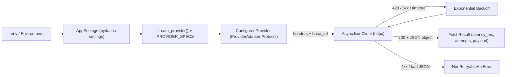

# Experiment 01: Typed Async API Client & Switchable Provider Configuration

**Classification:** `Experiment`  
**Track:** `01-python-ai-fundamentals`  
**Status:** `Completed`  
**Last Updated:** `2026-11-25`

---

## 1. Problem Statement

Before integrating live LLM APIs, an AI service needs a reliable Python engineering foundation:
1. Validated configuration loaded from environment variables without exposing secrets in logs or tracebacks.
2. A single, switchable provider contract so experiments can toggle between **Google Gemini (free tier)**, **OpenAI**, **Anthropic**, and local **Ollama** via configuration rather than rewriting calling code.
3. An asynchronous HTTP client with explicit timeouts, bounded retries with exponential backoff on transient failures (`429`, `5xx`, timeouts), and fast failure on deterministic client/payload errors.

---

## 2. Relevant Technical Concepts

For a Kotlin/Android engineer, these Python constructs map directly to familiar patterns:

| Concept | Python Implementation | Android / Kotlin Equivalent | Why It Matters in AI Engineering |
| --- | --- | --- | --- |
| Typed immutable data & JSON parsing | `pydantic.BaseModel` (`ConfigDict(frozen=True)`) | `data class` + `kotlinx.serialization` / Moshi | Enforces strict schema validation on untrusted API/LLM payloads |
| Environment settings & secret masking | `pydantic-settings` (`BaseSettings`) + `SecretStr` | BuildConfig / encrypted local config | Fails fast on missing keys and masks credentials (`**********`) in `repr()` |
| Structural interface / DI contract | `typing.Protocol` | `interface` | Decouples orchestration from specific LLM providers |
| Non-blocking I/O | `asyncio` + `httpx.AsyncClient` | Kotlin Coroutines + OkHttp/Retrofit | Allows concurrent API calls and streaming without blocking threads |
| Uniform provider table | `dict[ProviderName, ProviderSpec]` | Enum / sealed mapping | Eliminates fragile `if/elif` chains when adding or switching providers |

---

## 3. Objectives & Success Criteria

- [x] Load and validate switchable settings for `gemini`, `openai`, `anthropic`, and `ollama` via `.env`.
- [x] Protect API keys with `SecretStr` so secrets never appear in `repr()` or resolved metadata.
- [x] Implement an async `httpx` client with explicit timeouts, bounded retries (`429`, `5xx`, network timeouts), and non-retryable failure handling (`4xx`, malformed JSON).
- [x] Verify all behavior with fast, offline unit tests (`httpx.MockTransport` + `pytest`).

---

## 4. Prerequisites & Setup

### Requirements
- Python `3.13+`
- `uv`

### Setup Steps

```bash
cd 01-python-ai-fundamentals/exp-01-async-api-and-structured-data
uv sync
cp .env.example .env
# Optional: set LLM_PROVIDER and keys in .env (not required for offline tests/demo)
```

### Environment Variables

| Variable | Required | Description | Default |
| --- | --- | --- | --- |
| `LLM_PROVIDER` | No | Active provider (`gemini`, `openai`, `anthropic`, `ollama`) | `gemini` |
| `GEMINI_API_KEY` | For live Gemini | Google AI Studio API key | None |
| `OPENAI_API_KEY` | For live OpenAI | OpenAI API key | None |
| `ANTHROPIC_API_KEY` | For live Anthropic | Anthropic API key | None |
| `OLLAMA_BASE_URL` | No | Local Ollama server URL | `http://localhost:11434` |
| `HTTP_TIMEOUT_SECONDS` | No | Per-request timeout (`> 0`, `<= 120`) | `10.0` |
| `HTTP_MAX_RETRIES` | No | Max retry attempts (`0..5`) | `2` |

---

## 5. Solution Design & Architecture



### Component Responsibilities
- `config.py` (`AppSettings`): Loads `.env`, validates bounds, and resolves `(ResolvedProviderConfig, SecretStr | None)` uniformly.
- `providers.py` (`PROVIDER_SPECS`, `ProviderAdapter`, `ConfiguredProvider`): Data-driven registry mapping each provider to its auth header convention without `if/elif` branching.
- `client.py` (`AsyncJsonClient`): Async context-managed `httpx` wrapper supporting dependency-injected `AsyncBaseTransport`, retry classification, and wall-clock latency capture.
- `models.py`: Immutable Pydantic contracts and explicit exception hierarchy (`RetryableApiError`, `NonRetryableApiError`).

### Selected Technologies & Trade-offs

| Choice | Alternatives Considered | Why Selected | Trade-offs / Revisit Trigger |
| --- | --- | --- | --- |
| `httpx.AsyncClient` | `aiohttp`, `requests` | Supports sync/async, HTTP/2, clean `Timeout` config, and built-in `MockTransport` for deterministic tests | Slightly heavier than `urllib`; keep `httpx` until SDK-only features (like complex streaming helpers) justify official SDKs |
| `pydantic` + `pydantic-settings` | `dataclasses` + `os.environ` | Automatic type coercion, range checks, `SecretStr` masking, and direct alignment with structured LLM outputs in Track 02 | Adds runtime dependency; justified because schema validation is central to GenAI apps |
| `typing.Protocol` + spec dict | Abstract base classes (`abc.ABC`) + `if/elif` | Structural typing (duck typing with static type checking) and zero inheritance coupling | Does not enforce method bodies at import time unless tested (`@runtime_checkable` + unit tests) |

---

## 6. Implementation Notes

```text
exp-01-async-api-and-structured-data/
├── README.md
├── pyproject.toml
├── .env.example
├── src/
│   └── async_api_lab/
│       ├── __init__.py
│       ├── client.py
│       ├── config.py
│       ├── main.py
│       ├── models.py
│       └── providers.py
└── tests/
    ├── test_client.py
    ├── test_config.py
    └── test_providers.py
```

---

## 7. Expected Inputs & Outputs

### Input (`.env` / `AppSettings`)
```env
LLM_PROVIDER=gemini
HTTP_TIMEOUT_SECONDS=10.0
HTTP_MAX_RETRIES=2
```

### Output (`uv run python -m async_api_lab.main`)
Prints the normalized status of all four switchable providers (`has_api_key` boolean, never raw secrets) followed by a `FetchResult` JSON payload showing simulated `503 -> 200` retry recovery:

```json
{
  "url": "https://generativelanguage.googleapis.com/health",
  "status_code": 200,
  "latency_ms": 52.1,
  "attempts": 2,
  "payload": {
    "status": "ok",
    "endpoint": "https://generativelanguage.googleapis.com/health",
    "note": "Simulated recovery on retry attempt 2"
  }
}
```

---

## 8. Running & Testing

```bash
# Lint
uv run ruff check .

# Run offline unit tests
uv run pytest -v

# Run simulated CLI demo
uv run python -m async_api_lab.main
```

### Observed Test Scope
- `uv run ruff check .` — Passed with 0 lint errors.
- `uv run pytest -v` — `18 passed` (offline unit tests using `httpx.MockTransport` and isolated `AppSettings(_env_file=None)`; no live network or paid API calls).
- `uv run python -m async_api_lab.main` — Verified all 4 switchable provider configs (`gemini`, `openai`, `anthropic`, `ollama`) and simulated `503 -> 200` retry recovery.

---

## 9. Limitations, Security & Known Issues

- **No live LLM calls yet:** This experiment intentionally stops at configuration, provider abstraction, and resilient JSON HTTP transport; real LLM request/response payloads are introduced in Track `02-llm-experiments`.
- **Simple backoff:** Uses deterministic exponential backoff without random jitter; production high-concurrency clients should add jitter to avoid thundering-herd retries.
- **Security note:** `SecretStr` masks secrets in `repr()`, and `AsyncJsonClient` never logs headers, though callers must still avoid printing `build_headers()` output directly.

---

## 10. What I Learned

- `pydantic-settings` + `SecretStr` provides clean fail-fast environment validation and secret masking with very little boilerplate compared to manual `os.getenv` parsing.
- Replacing `if/elif` provider branching with a `PROVIDER_SPECS` dictionary + `getattr` field naming keeps adding or switching providers predictable and easy to test via `@pytest.mark.parametrize`.
- `httpx.MockTransport` makes testing `429`/`5xx` retries, timeouts, and malformed JSON fast and deterministic without needing a local HTTP server or mocking private library internals.

---

## 11. Possible Next Experiments

1. **`02-llm-experiments/exp-01-switchable-llm-client`:** Plug real text-generation adapters for Gemini (free tier), OpenAI, Anthropic, and local Ollama into this `ProviderAdapter` architecture, measuring token usage and TTFT/total latency.
2. **`02-llm-experiments/exp-02-structured-outputs-and-streaming`:** Extend the normalized response contract with Pydantic-enforced structured JSON outputs and SSE streaming.
