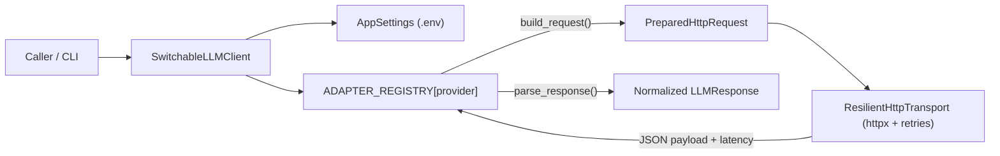

# Experiment 01: Switchable Multi-Provider LLM Client

**Classification:** `Experiment`  
**Track:** `02-llm-experiments`  
**Status:** `Completed`  
**Last Updated:** `2026-11-25`

---

## 1. Problem Statement

Every major LLM vendor exposes a slightly different HTTP wire contract (endpoint path, authentication header, system-instruction placement, output nesting, and token usage field names). Coupling application code directly to one vendor creates lock-in and hides how model APIs actually work.

This experiment builds a single **configurable, switchable async LLM client** supporting **Google Gemini**, **OpenAI**, **Anthropic**, and local **Ollama** via `.env` configuration.

---

## 2. Relevant Technical Concepts

- **Stateless Text Generation:** Each HTTP `POST` sends system instructions, user prompt, and generation bounds (`temperature`, `max_output_tokens`) and receives generated text plus a stop/finish reason.
- **Wire-Protocol Normalization:** Each vendor structures payloads differently:
  - **Gemini:** `POST /v1beta/models/{model}:generateContent` (`x-goog-api-key`, `systemInstruction`, `usageMetadata`)
  - **OpenAI (Responses API):** `POST /v1/responses` (`Authorization: Bearer`, `instructions`, `output[].content[].text`, `usage.input_tokens` / `output_tokens`)
  - **Anthropic (Messages API):** `POST /v1/messages` (`x-api-key` + `anthropic-version`, top-level `system`, `content[].text`, `usage`)
  - **Ollama:** `POST /api/chat` (local, no key, `stream: false`, `prompt_eval_count` / `eval_count`)
- **Adapter Pattern (`Protocol`):** Separates vendor-specific JSON serialization/parsing from shared retry, timeout, and logging logic.

---

## 3. Objectives & Success Criteria

- [x] Switch active provider (`gemini | openai | anthropic | ollama`) via `LLM_PROVIDER` or per-call override.
- [x] Normalize text output, finish reason, token counts, attempts, and latency into `LLMResponse`.
- [x] Share one resilient `httpx` retry/timeout transport across all four adapters.
- [x] Verify request/response mapping and error handling offline with `pytest` + `httpx.MockTransport`.

---

## 4. Prerequisites & Setup

### Requirements
- Python `3.13+`
- `uv`
- Optional for `--live`: a free-tier `GEMINI_API_KEY` from Google AI Studio, OpenAI/Anthropic key, or local `ollama` running on `localhost:11434`.

### Setup Steps

```bash
cd 02-llm-experiments/exp-01-switchable-llm-client
uv sync
cp .env.example .env
# Optional: set LLM_PROVIDER and API key in .env for --live runs
```

### Environment Variables

| Variable | Required | Description | Default |
| --- | --- | --- | --- |
| `LLM_PROVIDER` | No | Active provider (`gemini`, `openai`, `anthropic`, `ollama`) | `gemini` |
| `GEMINI_API_KEY` | For live Gemini | Google AI Studio API key | None |
| `OPENAI_API_KEY` | For live OpenAI | OpenAI API key | None |
| `ANTHROPIC_API_KEY` | For live Anthropic | Anthropic API key | None |
| `OLLAMA_BASE_URL` | No | Local Ollama URL | `http://localhost:11434` |
| `HTTP_TIMEOUT_SECONDS` | No | Request timeout (`> 0`, `<= 120`) | `30.0` |
| `HTTP_MAX_RETRIES` | No | Retry budget (`0..5`) | `2` |

---

## 5. Solution Design & Architecture

See [ADR-0001](../../06-ai-system-architecture/adr-0001-switchable-llm-provider-abstraction.md) for the full options analysis behind choosing thin direct `httpx` REST adapters over 4 separate SDKs or wrapper libraries.



### Component Responsibilities
- `config.py`: Resolves per-provider model, base URL, and `SecretStr` key validation.
- `adapters.py`: Pure wire translators (`GeminiAdapter`, `OpenAIAdapter`, `AnthropicAdapter`, `OllamaAdapter`) implementing `LLMProvider`.
- `transport.py`: Single shared async HTTP POST engine handling timeouts, `429`/`5xx` exponential backoff, and non-retryable `4xx`/JSON errors.
- `client.py`: Orchestrates settings, adapter selection, transport call, and token/latency logging.

---

## 6. Implementation Notes

```text
exp-01-switchable-llm-client/
├── README.md
├── pyproject.toml
├── .env.example
├── src/
│   └── llm_client_lab/
│       ├── __init__.py
│       ├── adapters.py
│       ├── client.py
│       ├── config.py
│       ├── main.py
│       ├── models.py
│       └── transport.py
└── tests/
    ├── test_adapters.py
    ├── test_client.py
    └── test_config.py
```

---

## 7. Expected Inputs & Outputs

### Input (`LLMRequest`)
```json
{
  "prompt": "Why should an AI client decouple provider wire formats behind a Protocol?",
  "system_prompt": "Answer concisely in one engineering sentence.",
  "temperature": 0.2,
  "max_output_tokens": 128
}
```

### Output (`LLMResponse`)
```json
{
  "provider": "gemini",
  "model": "gemini-2.5-flash",
  "text": "Clean Architecture isolates domain rules from model vendor HTTP details.",
  "finish_reason": "STOP",
  "usage": {
    "input_tokens": 18,
    "output_tokens": 11,
    "total_tokens": 29
  },
  "latency_ms": 1.15,
  "attempts": 1
}
```

---

## 8. Running & Testing

```bash
# Lint
uv run ruff check .

# Run offline unit tests
uv run pytest -v

# Run offline 4-provider simulated demo
uv run python -m llm_client_lab.main

# Optional: run a real call (uses LLM_PROVIDER + key from .env, or override --provider)
uv run python -m llm_client_lab.main --live --provider gemini
```

### Observed Test Scope
- `uv run ruff check .` — Passed (`All checks passed!`).
- `uv run pytest -v` — `16 passed in 1.05s` (offline unit tests using `httpx.MockTransport` and isolated `AppSettings(_env_file=None)`; no live API calls executed).
- `uv run python -m llm_client_lab.main` — Verified offline simulated routing across all 4 providers (`gemini`, `openai`, `anthropic`, `ollama`) with normalized `LLMResponse` JSON output.

---

## 9. Limitations, Security & Known Issues

- **Non-streaming only:** Sets `"stream": false` / non-streaming endpoints; SSE streaming and Pydantic-enforced JSON outputs belong to Experiment 2 (`exp-02-structured-outputs-and-streaming`).
- **Single-turn helper:** `LLMRequest` sends a single user prompt (+ optional system prompt) rather than multi-turn message history.
- **Free-tier privacy:** When running `--live` against Google Gemini's free tier, avoid sending confidential or client data per provider terms.

---

## 10. What I Learned

- Even simple concepts like "system prompt" and "token usage" differ across every vendor (`systemInstruction` vs. `instructions` vs. `system` vs. `messages[0]`, and `usageMetadata` vs. `usage` vs. `eval_count`).
- Keeping adapters pure (`build_request` / `parse_response`) lets one `ResilientHttpTransport` own all retries, timeouts, and latency metrics without duplicating network code four times.

---

## 11. Possible Next Experiments

1. **`02-llm-experiments/exp-02-structured-outputs-and-streaming`:** Add JSON schema / Pydantic-validated structured outputs and Server-Sent Events (SSE) streaming across providers.
2. **`02-llm-experiments/exp-03-prompt-and-model-comparison`:** Run a small prompt-contract comparison benchmark between Gemini Flash (cloud) and local Ollama models.
