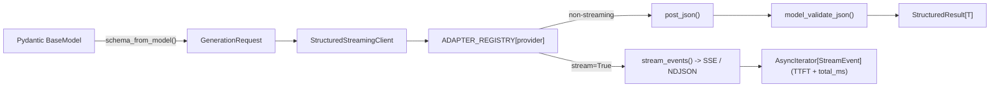

# Experiment 02: Structured Outputs & Streaming Responses

**Classification:** `Experiment`  
**Track:** `02-llm-experiments`  
**Status:** `Completed`  
**Last Updated:** `2026-11-25`

---

## 1. Problem Statement

Real applications rarely consume unstructured prose or block UI threads waiting for a complete multi-second generation:
1. Prompting *"return valid JSON"* is brittle without provider-level JSON Schema enforcement and post-generation validation.
2. Rendering responses only after completion degrades UX; clients need incremental streaming to separate **Time To First Token (TTFT)** from **total generation latency**.
3. Providers use different schema parameters and different streaming wire protocols (**SSE** vs. **NDJSON**).

---

## 2. Relevant Technical Concepts

- **Constrained Decoding / JSON Schema Outputs:**
  - **Gemini:** `generationConfig.responseMimeType = "application/json"` + `responseJsonSchema`
  - **OpenAI (Responses API):** `text.format = {"type": "json_schema", "strict": true, "schema": ...}` (requires `"additionalProperties": false`)
  - **Anthropic (Messages API):** `output_config.format = {"type": "json_schema", "schema": ...}`
  - **Ollama (`/api/chat`):** `format = <json_schema>`
- **Streaming Wire Framing:**
  - **SSE (`text/event-stream`):** Used by Gemini (`streamGenerateContent?alt=sse`), OpenAI (`stream: true`), and Anthropic (`stream: true`), delivering `data: {...}` events.
  - **NDJSON (`application/x-ndjson`):** Used by Ollama (`stream: true`), delivering one standalone JSON object per line until `"done": true`.
- **Partial JSON Gotcha:** Streamed chunks contain partial JSON fragments; validate with Pydantic only after accumulating the complete text, and always inspect `finish_reason` for token-limit truncation.

---

## 3. Objectives & Success Criteria

- [x] Generate strict JSON Schemas from any `pydantic.BaseModel` (`schema_from_model` enforcing `additionalProperties: false`).
- [x] Validate structured outputs with Pydantic and raise `SchemaValidationError` (preserving `raw_text` and `finish_reason`) on malformed or truncated payloads.
- [x] Stream normalized `StreamEvent` deltas across SSE (Gemini, OpenAI, Anthropic) and NDJSON (Ollama) while capturing `ttft_ms`, `total_ms`, and `TokenUsage`.
- [x] Verify all parsers, adapters, and truncation/error paths offline with `pytest` + `httpx.MockTransport`.

---

## 4. Prerequisites & Setup

```bash
cd 02-llm-experiments/exp-02-structured-outputs-and-streaming
uv sync
cp .env.example .env
# Optional for --live: add GEMINI_API_KEY (or another provider key / local Ollama)
```

---

## 5. Solution Design & Architecture



---

## 6. Implementation Notes

```text
exp-02-structured-outputs-and-streaming/
├── README.md
├── pyproject.toml
├── .env.example
├── src/
│   └── structured_stream_lab/
│       ├── __init__.py
│       ├── adapters.py
│       ├── client.py
│       ├── config.py
│       ├── main.py
│       ├── models.py
│       └── streaming.py
└── tests/
    ├── test_adapters.py
    ├── test_client.py
    └── test_streaming.py
```

---

## 7. Expected Inputs & Outputs

### Structured Extraction Output (`ArchitectureFinding`)
```json
{
  "provider": "gemini",
  "model": "gemini-2.5-flash",
  "data": {
    "summary": "Enforcing JSON Schema at decoding prevents prose wrapping.",
    "risk_level": "medium",
    "recommended_actions": [
      "Validate model output with Pydantic",
      "Inspect finish_reason for max_output_tokens truncation"
    ]
  },
  "finish_reason": "STOP",
  "usage": {
    "input_tokens": 42,
    "output_tokens": 31,
    "total_tokens": 73
  }
}
```

---

## 8. Running & Testing

```bash
uv run ruff check .
uv run pytest -v
uv run python -m structured_stream_lab.main
# Optional live test:
uv run python -m structured_stream_lab.main --live --provider gemini
```

### Observed Test Scope
- `uv run ruff check .` — Passed (`All checks passed!`).
- `uv run pytest -v` — `13 passed in 1.31s` (offline unit tests covering SSE/NDJSON framing, strict JSON Schema generation across all 4 providers, `SchemaValidationError` on truncated JSON, and simulated streaming lifecycle; no live API calls executed).
- `uv run python -m structured_stream_lab.main` — Verified offline simulated Pydantic extraction (`ArchitectureFinding`) and SSE streaming (`ttft_ms=10.83`, `total_ms=21.97`).

---

## 9. Limitations, Security & Known Issues

- **Streaming failure mid-stream:** `stream_events()` raises immediately on transport errors rather than retrying mid-stream (retrying mid-stream without duplicating already-emitted tokens requires stateful resume logic).
- **Schema recursion limits:** `_enforce_strict_objects()` handles standard Pydantic schemas; recursive self-referential schemas or complex provider-specific unsupported JSON Schema keywords should be tested against the target provider.

---

## 10. What I Learned

- Supporting both **SSE** (Gemini/OpenAI/Anthropic) and **NDJSON** (Ollama) cleanly requires isolating framing (`iter_sse_json` vs. `iter_ndjson`) from provider payload parsing (`parse_stream_event`).
- Streaming Anthropic requires stateful accumulation across `message_start` (`input_tokens`) and `message_delta` (`output_tokens`, `stop_reason`), whereas Ollama delivers final token counts on the terminal `done: true` line.

---

## 11. Possible Next Experiments

1. **`02-llm-experiments/exp-03-context-window-and-model-comparison`:** Measure prompt/context scaling and compare Gemini Flash vs. local Ollama on structured extraction accuracy and latency.
2. **`03-rag-systems/exp-01-embeddings-and-similarity-from-scratch`:** Begin Track 03 with embeddings and cosine similarity in plain NumPy/Python before adding a vector store.
