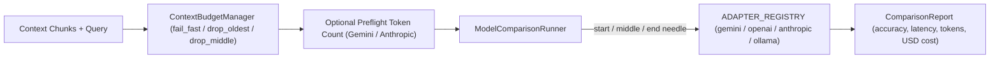

# Experiment 03: Context Window Budgeting & Model Comparison

**Classification:** `Experiment`  
**Track:** `02-llm-experiments`  
**Status:** `Completed`  
**Last Updated:** `2026-11-26`

---

## 1. Problem Statement

Choosing a model and assembling prompts requires balancing **context limits**, **positional recall**, **latency**, and **cost**:
1. Exceeding context limits triggers `400` errors in cloud APIs or silent prompt truncation in local Ollama (`options.num_ctx`).
2. Long contexts suffer from **"lost in the middle"** attention decay, where facts buried mid-context are missed more often than facts at the start or end.
3. Architects need preflight token budgeting and reproducible apples-to-apples comparisons across cloud and local models.

---

## 2. Relevant Technical Concepts

- **Context Window Accounting:** Every request consumes `system_prompt + history + context_chunks + max_output_tokens`. Reserving output tokens upfront prevents truncated replies.
- **Overflow Policies:**
  - `fail_fast`: Reject oversized requests explicitly (`ContextBudgetExceededError`) instead of silently losing evidence.
  - `drop_oldest`: Sliding-window eviction suited to chat history.
  - `drop_middle`: Preserves leading instructions/anchors and most-recent context while evicting lower-priority middle chunks.
- **Preflight Token Counting:**
  - **Gemini:** `POST /v1beta/models/{model}:countTokens` (`totalTokens`)
  - **Anthropic:** `POST /v1/messages/count_tokens` (`input_tokens`)
  - **Ollama:** `options.num_ctx` explicitly controls local context window allocation.
- **Needle-in-a-Haystack Probe:** Places a known target fact at `start (0%)`, `middle (50%)`, and `end (100%)` to surface positional recall degradation alongside latency and estimated USD cost.

---

## 3. Objectives & Success Criteria

- [x] Implement `ContextBudgetManager` supporting `fail_fast`, `drop_oldest`, and `drop_middle` policies.
- [x] Support preflight token counting for Gemini (`:countTokens`) and Anthropic (`/v1/messages/count_tokens`), plus explicit `num_ctx` forwarding for Ollama.
- [x] Implement a multi-provider needle-in-a-haystack comparison runner reporting accuracy, average latency, token usage, and estimated cost.
- [x] Verify all budgeting, adapter payloads, and comparison scoring offline with `pytest` + `httpx.MockTransport`.

---

## 4. Prerequisites & Setup

```bash
cd 02-llm-experiments/exp-03-context-window-and-model-comparison
uv sync
cp .env.example .env
# Optional for --live: set GEMINI_API_KEY (or OpenAI/Anthropic) and/or start local Ollama
```

---

## 5. Solution Design & Architecture



---

## 6. Implementation Notes

```text
exp-03-context-window-and-model-comparison/
├── README.md
├── pyproject.toml
├── .env.example
├── src/
│   └── context_compare_lab/
│       ├── __init__.py
│       ├── budget.py
│       ├── comparison.py
│       ├── config.py
│       ├── main.py
│       ├── models.py
│       ├── providers.py
│       └── transport.py
└── tests/
    ├── test_budget.py
    ├── test_comparison.py
    └── test_providers.py
```

---

## 7. Expected Inputs & Outputs

Running `uv run python -m context_compare_lab.main` prints:
1. A `PackedContext` JSON object showing middle chunk eviction (`dropped_chunk_ids`) under `drop_middle`.
2. A `ComparisonReport` JSON object comparing `gemini` (`accuracy: 1.0`) vs. simulated `ollama` (`accuracy: 0.6667`, missing the middle needle) with token counts, latency, and estimated cost.

---

## 8. Running & Testing

```bash
uv run ruff check .
uv run pytest -v
uv run python -m context_compare_lab.main
# Optional live comparison:
uv run python -m context_compare_lab.main --live --providers gemini,ollama
```

### Observed Test Scope
- `uv run ruff check .` — Passed (`All checks passed!`).
- `uv run pytest -v` — `10 passed in 1.46s` (offline unit tests covering `fail_fast` / `drop_oldest` / `drop_middle` context packing, Gemini `:countTokens` & Anthropic `/messages/count_tokens` preflight payloads, Ollama `num_ctx` forwarding, needle placement, and comparison scoring).
- `uv run python -m context_compare_lab.main` — Verified offline `drop_middle` packing and `gemini` vs. simulated `ollama` needle-in-a-haystack comparison report.

---

## 9. Limitations, Security & Known Issues

- **Conservative local estimator:** `estimate_tokens()` uses a character-ratio heuristic (~3.5 chars/token) when offline or when a provider lacks a preflight count endpoint; always keep a safety buffer or use `:countTokens` / `count_tokens` before tight context calls.
- **Static pricing table:** `DEFAULT_PRICING` contains illustrative reference rates and should be updated from vendor pricing pages before using cost outputs for financial budgeting.

---

## 10. What I Learned

- Reserving `max_output_tokens` *before* packing input chunks avoids subtle output truncation bugs.
- Explicit overflow strategies (`fail_fast` vs. `drop_oldest` vs. `drop_middle`) turn implicit silent context truncation into an observable architectural choice.

---

## 11. Possible Next Experiments

1. **`03-rag-systems/exp-01-embeddings-and-similarity-from-scratch`:** Build embeddings and cosine similarity in plain Python/NumPy before adding a vector database.
2. **`03-rag-systems/exp-02-grounded-rag-with-citations-and-evals`:** Combine context budgeting, grounded citations, and retrieval evaluations.
