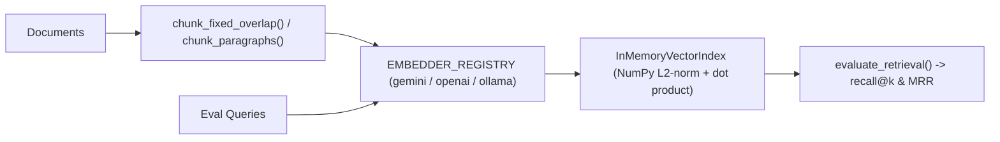

# Experiment 01: Embeddings & Cosine Similarity from Scratch

**Classification:** `Experiment`  
**Track:** `03-rag-systems`  
**Status:** `Completed`  
**Last Updated:** `2026-11-26`

---

## 1. Problem Statement

Before adopting a vector database or RAG framework, an engineer should understand:
1. How documents are split into overlapping or paragraph-aware chunks without losing provenance (`doc_id`, `start_char`, `end_char`).
2. How dense embedding APIs work across cloud and local models (`gemini-embedding-001`, `text-embedding-3-small`, `nomic-embed-text`).
3. How cosine similarity and L2-normalized dot-product search rank candidates in NumPy.
4. Where dense semantic search shines (paraphrases) and where it fails (exact SKUs/IDs).

---

## 2. Relevant Technical Concepts

- **L2 Normalization & Cosine Similarity:** Normalizing vectors to unit length turns cosine similarity ($\frac{A \cdot B}{\|A\|\|B\|}$) into a single matrix dot product (`matrix @ query`), insensitive to vector magnitude.
- **Asymmetric Retrieval (`taskType`):** Gemini's `embedContent` accepts `RETRIEVAL_DOCUMENT` for corpus chunks and `RETRIEVAL_QUERY` for search queries.
- **Provider Landscape:** Gemini (`:embedContent`), OpenAI (`/v1/embeddings`), and Ollama (`/api/embed`) expose native embedding endpoints; Anthropic does not expose a native embedding API, so Claude generation pairs with one of those embedders.
- **Retrieval Evaluation:** `recall@k` measures whether relevant documents appear in top-k; **MRR** (Mean Reciprocal Rank) rewards ranking the right document first.

---

## 3. Objectives & Success Criteria

- [x] Implement fixed-overlap and paragraph-aware chunkers with character-offset provenance.
- [x] Implement switchable REST embedding adapters (`gemini`, `openai`, `ollama`) plus explicit guidance if `anthropic` is requested.
- [x] Build a pure NumPy `InMemoryVectorIndex` (`l2_normalize`, `cosine_similarity_scores`, `search`) with zero-norm and dimension guards.
- [x] Verify chunking, math, adapter payloads, and `recall@k` / `MRR` evaluation offline with `pytest`.

---

## 4. Prerequisites & Setup

```bash
cd 03-rag-systems/exp-01-embeddings-and-similarity-from-scratch
uv sync
cp .env.example .env
# Optional for --live: set GEMINI_API_KEY (or OPENAI_API_KEY / local Ollama with nomic-embed-text)
```

---

## 5. Solution Design & Architecture



---

## 6. Implementation Notes

```text
exp-01-embeddings-and-similarity-from-scratch/
├── README.md
├── pyproject.toml
├── .env.example
├── src/
│   └── embeddings_lab/
│       ├── __init__.py
│       ├── chunking.py
│       ├── config.py
│       ├── embedders.py
│       ├── evaluation.py
│       ├── main.py
│       ├── models.py
│       ├── similarity.py
│       └── transport.py
└── tests/
    ├── test_chunking.py
    ├── test_embedders.py
    ├── test_evaluation.py
    └── test_similarity.py
```

---

## 7. Expected Inputs & Outputs

Running `uv run python -m embeddings_lab.main` prints chunk counts comparing fixed-overlap vs. paragraph splitting, followed by a `RetrievalEvalReport` JSON showing `recall@1 = 1.0` on semantic paraphrases and `0.0` on bare `SKU-4812-X` lookup (illustrating why Track 03 later combines dense vectors with lexical/BM25 search).

---

## 8. Running & Testing

```bash
uv run ruff check .
uv run pytest -v
uv run python -m embeddings_lab.main
# Optional live test:
uv run python -m embeddings_lab.main --live --provider gemini
```

### Observed Test Scope
- `uv run ruff check .` — Passed (`All checks passed!`).
- `uv run pytest -v` — `12 passed in 0.12s` (offline unit tests covering fixed-overlap/paragraph chunking, zero-norm L2 normalization & cosine similarity, Gemini/OpenAI/Ollama embedder payloads + Anthropic guidance error, and `recall@k` / `MRR` evaluation).
- `uv run python -m embeddings_lab.main` — Verified offline chunking comparison and toy concept-space evaluation (`mean_recall_at_k=0.6667`, `mrr=0.6667`).

---

## 9. Limitations, Security & Known Issues

- **Brute-force O(N) search:** Matrix dot-product scan is fast for hundreds/thousands of chunks in memory; larger corpora motivate ANN indexes (HNSW/IVF) in vector stores.
- **No lexical fallback yet:** Bare alphanumeric identifiers (`SKU-4812-X`, error codes) require hybrid BM25 + vector retrieval in the next experiment.

---

## 10. What I Learned

- L2-normalizing document vectors once at index time makes query-time cosine similarity a single `matrix @ query` dot product, while guarding zero-norm vectors prevents `NaN` propagation.
- Evaluating `recall@k` and `MRR` immediately surfaces where semantic vectors struggle on exact identifiers, giving concrete evidence for hybrid search.

---

## 11. Possible Next Experiments

1. **`03-rag-systems/exp-02-grounded-rag-with-citations-and-evals`:** Combine hybrid/vector retrieval with grounded LLM generation, strict citations, abstention on missing context, and faithfulness checks.
2. **`03-rag-systems/exp-03-chunking-and-hybrid-search-comparison`:** Compare dense-only vs. BM25 + dense hybrid scoring with Reciprocal Rank Fusion (RRF).
