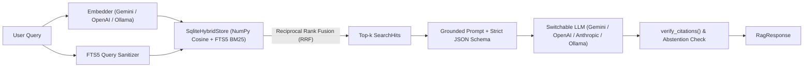

# Proof of Concept 02: Grounded RAG with Hybrid Retrieval, Citations & Evals

**Classification:** `Proof of Concept`  
**Track:** `03-rag-systems`  
**Status:** `Completed`  
**Last Updated:** `2026-11-26`

---

## 1. Problem Statement

A practical Retrieval-Augmented Generation (RAG) service fails in production when it relies solely on dense vectors or trusts LLM prose blindly:
1. Dense embeddings miss exact identifiers (`SKU-4812-X`, policy IDs, error codes).
2. LLMs may answer from pretraining memory or invent nonexistent chunk IDs when retrieved context is incomplete.
3. Without automated retrieval + faithfulness metrics, teams cannot tell whether an error came from retrieval or generation.

---

## 2. Requirements

### Functional Requirements
- Ingest chunks into persistent local storage with both lexical (`FTS5`) and dense vector representations.
- Support `dense`, `bm25`, and `hybrid` (Reciprocal Rank Fusion) retrieval behind a clean `Retriever` `Protocol`.
- Allow independent configuration of `LLM_PROVIDER` (`gemini | openai | anthropic | ollama`) and `EMBEDDING_PROVIDER` (`gemini | openai | ollama`).
- Enforce structured JSON output (`GroundedAnswer`) with explicit `abstained` flag and verbatim `citations`, verified programmatically against retrieved chunks.
- Evaluate retrieval (`recall@k`, `MRR`) and generation faithfulness (`citation_validity_rate`, `abstention_accuracy`).

### Non-Functional Requirements
- Zero external server or Docker prerequisites (`sqlite3` + `FTS5` + `numpy`).
- 100% deterministic offline testability via `:memory:` SQLite and `httpx.MockTransport`.
- Fail-safe handling of FTS5 punctuation (`SKU-4812-X`) and missing credentials (`SecretStr`).

---

## 3. High-Level Architecture & Data Flow

See [ADR-0002](../../06-ai-system-architecture/adr-0002-hybrid-retrieval-and-local-vector-store.md) for the storage and hybrid retrieval decision analysis.



### Component Responsibilities
- `store.py` (`SqliteHybridStore`): ACID chunk + embedding persistence, `FTS5` BM25 search, NumPy cosine ranking, and RRF fusion.
- `providers.py`: Independent `LLM_REGISTRY` and `EMBEDDER_REGISTRY` so Claude generation can pair with Gemini/OpenAI/Ollama embeddings.
- `rag.py` (`GroundedRagPipeline`): Orchestrates embedding, hybrid retrieval, schema-constrained generation, and programmatic citation verification.
- `evaluation.py`: Scores retrieval (`recall@k`, `MRR`) alongside faithfulness (`citation_validity_rate`, `abstention_accuracy`).

---

## 4. Prerequisites & Setup

```bash
cd 03-rag-systems/exp-02-grounded-rag-with-citations-and-evals
uv sync
cp .env.example .env
# Optional for --live: set GEMINI_API_KEY (or another LLM/embedder pair)
```

---

## 5. Quality Attributes & Architecture Trade-offs

- **Security & Privacy:** All index data stays local (`*.sqlite3` gitignored). `verify_citations()` prevents silent fabricated references from reaching callers.
- **Scalability & Reliability:** SQLite transactions guarantee atomic writes; FTS5 sanitization prevents syntax crashes on hyphens/punctuation. Brute-force NumPy scan is bounded to small/medium POC corpora (< ~20k chunks), after which `Retriever` swaps cleanly to Qdrant/`pgvector`.
- **Cost & Performance:** RRF requires zero extra reranker LLM calls and works cleanly with zero-cost local Ollama or Gemini free tier.

---

## 6. Running & Testing

```bash
uv run ruff check .
uv run pytest -v
uv run python -m grounded_rag_poc.main
# Optional live run:
uv run python -m grounded_rag_poc.main --live --llm-provider gemini --embed-provider gemini
```

### Observed Test Scope
- `uv run ruff check .` — Passed (`All checks passed!`).
- `uv run pytest -v` — `9 passed in 2.38s` (offline tests covering SQLite `FTS5` sanitization, RRF hybrid ranking, SQLite file persistence, strict fabricated-citation rejection, abstention, Anthropic+Gemini pairing, and dense vs. hybrid evaluation).
- `uv run python -m grounded_rag_poc.main` — Verified offline comparison: `dense` (`mean_recall_at_k=0.5`, `abstention_accuracy=0.6667`) vs. `hybrid` (`mean_recall_at_k=1.0`, `citation_validity_rate=1.0`, `abstention_accuracy=1.0`).

---

## 7. Limitations & Future Improvements

- **Substring quote matching:** `verify_citations()` verifies verbatim whitespace-normalized quotes; future iterations can support fuzzy span matching or LLM-as-judge NLI faithfulness checks.
- **Chunking integration:** Uses pre-chunked `ChunkRecord` inputs; wiring Experiment 5's `chunk_paragraphs()` + PDF/Markdown loaders is the natural ingestion extension.
- **Next milestone:** Track `04-ai-agents` — Tool calling, deterministic state machines, and human-in-the-loop safety gates.
