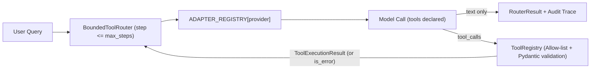

# Experiment 01: Bounded Multi-Provider Tool-Calling Router

**Classification:** `Experiment`  
**Track:** `04-ai-agents`  
**Status:** `Completed`  
**Last Updated:** `2026-11-26`

---

## 1. Problem Statement

Tool calling turns an LLM from a passive text generator into an orchestrator that can query APIs and compute deterministic values. However, unguarded tool loops fail in predictable ways:
1. Models may hallucinate unregistered tool names or malformed arguments.
2. Prompt injection inside tool outputs or ambiguous queries can cause infinite loops and runaway token spend.
3. Each LLM provider encodes tool declarations, calls, and tool results differently on the wire.

---

## 2. Relevant Technical Concepts

- **Execution Boundary:** The LLM only outputs a *request* to call a tool (`name` + arguments); the application validates inputs against Pydantic schemas, executes allow-listed Python functions locally, and feeds tool outputs back to the model.
- **Deterministic Router vs. Open-Ended Agent:** A bounded router with explicit `max_steps` and allow-listed read/compute tools handles logistics/support workflows predictably without open-ended agent autonomy risks.
- **Wire Formats:**
  - **Gemini:** `functionDeclarations` -> `functionCall` -> `functionResponse`
  - **OpenAI (Responses API):** `tools` (`strict: true`) -> `function_call` (`call_id`) -> `function_call_output`
  - **Anthropic (Messages API):** `tools` (`input_schema`) -> `tool_use` (`id`) -> `tool_result` (`tool_use_id`, `is_error`)
  - **Ollama (`/api/chat`):** `tools` -> `message.tool_calls` -> `role: "tool"`

---

## 3. Objectives & Success Criteria

- [x] Enforce an explicit `ToolRegistry` allow-list with Pydantic argument validation and structured `is_error` feedback.
- [x] Normalize multi-turn tool conversations across Gemini, OpenAI, Anthropic, and Ollama behind `ToolCallingAdapter`.
- [x] Enforce a hard `max_steps` loop budget (`MaxStepsExceededError`) and record a step-by-step `RouterTraceStep` audit trail.
- [x] Verify all 4 wire adapters, validation recovery, unknown-tool blocking, and step caps offline with `pytest`.

---

## 4. Prerequisites & Setup

```bash
cd 04-ai-agents/exp-01-tool-calling-router
uv sync
cp .env.example .env
# Optional for --live: set GEMINI_API_KEY (or OpenAI / Anthropic / local Ollama)
```

---

## 5. Solution Design & Architecture



---

## 6. Implementation Notes

```text
exp-01-tool-calling-router/
├── README.md
├── pyproject.toml
├── .env.example
├── src/
│   └── tool_router_lab/
│       ├── __init__.py
│       ├── adapters.py
│       ├── config.py
│       ├── main.py
│       ├── models.py
│       ├── router.py
│       ├── tools.py
│       └── transport.py
└── tests/
    ├── test_adapters.py
    ├── test_router.py
    └── test_tools.py
```

---

## 7. Expected Inputs & Outputs

Running `uv run python -m tool_router_lab.main` executes a simulated 3-step logistics inquiry (`SHP-1042`, `$200` order):
1. Step 1 invokes `lookup_shipment_status(tracking_id="SHP-1042")`.
2. Step 2 invokes `check_warehouse_stock(sku="SKU-4812-X", hub="BLR-01")` and `calculate_sla_refund(order_total_usd=200.0, delay_hours=18)`.
3. Step 3 synthesizes the final response (`14` units available, `$30.00` SLA credit) with cumulative token totals (`437` tokens).

---

## 8. Running & Testing

```bash
uv run ruff check .
uv run pytest -v
uv run python -m tool_router_lab.main
# Optional live call:
uv run python -m tool_router_lab.main --live --provider gemini
```

### Observed Test Scope
- `uv run ruff check .` — Passed (`All checks passed!`).
- `uv run pytest -v` — `11 passed in 0.94s` (offline tests covering `ToolRegistry` allow-list & Pydantic arg validation, multi-turn tool wire serialization/parsing for Gemini/OpenAI/Anthropic/Ollama, validation-error recovery, and `max_steps` enforcement).
- `uv run python -m tool_router_lab.main` — Verified 3-step offline logistics demo (`steps_taken=3`, `total_tokens=437`).

---

## 9. Limitations, Security & Known Issues

- **Read/compute tools only:** All registered tools in Experiment 1 are read-only or pure calculations; mutating/side-effecting actions (issuing refunds, dispatching shipments) require explicit human-in-the-loop approval gates in Experiment 2 (`exp-02-bounded-agent-with-human-approval`).
- **Synchronous local tool handlers:** `ToolRegistry.execute` runs handlers synchronously; I/O-bound external APIs should use `async` handlers in larger workflows.

---

## 10. What I Learned

- Returning Pydantic validation errors as structured `is_error=True` tool results lets the model self-correct or ask the user for clarification instead of crashing the entire orchestration pipeline.
- Expressing multi-turn history as typed `ConversationTurn` variants keeps all 4 provider wire differences isolated inside `adapters.py`.

---

## 11. Possible Next Experiments

1. **`04-ai-agents/exp-02-bounded-agent-with-human-approval`:** Add explicit state-machine transitions and a human-in-the-loop (HITL) approval gate before executing state-changing tools.
2. **`05-android-on-device-ai/exp-01-android-on-device-summarizer`:** Explore Android Gemini Nano / ML Kit GenAI on-device inference and offline privacy trade-offs.
