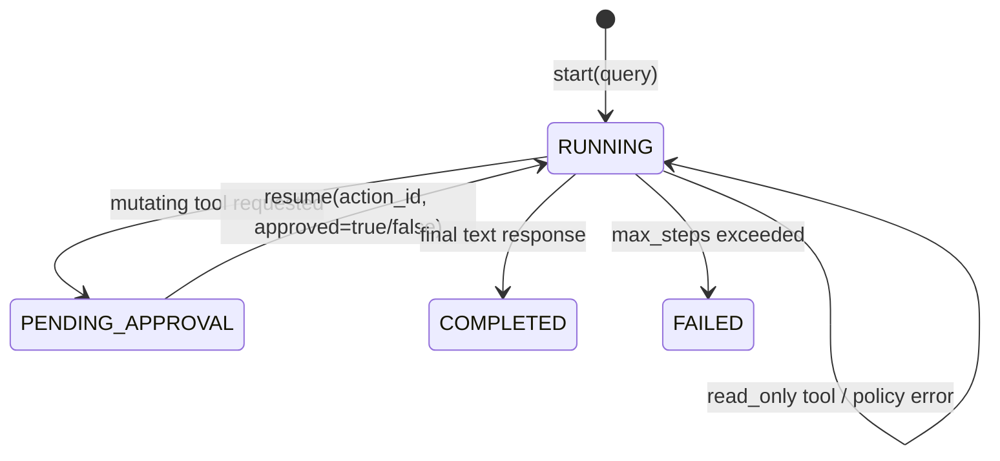

# Proof of Concept 02: Bounded Agent with Human-in-the-Loop Approval Gate

**Classification:** `Proof of Concept`  
**Track:** `04-ai-agents`  
**Status:** `Completed`  
**Last Updated:** `2026-11-26`

---

## 1. Problem Statement

When AI workflows move beyond read-only lookups to **side-effecting actions** (issuing monetary refunds, dispatching inventory), autonomous execution creates unacceptable financial and security exposure:
1. Indirect prompt injections embedded in external records can hijack model tool calls.
2. Blocking `input()` prompts break async servers and mobile approval flows.
3. Multi-tool LLM turns must preserve 1:1 `call_id` pairing across pause/resume boundaries.

---

## 2. Requirements

### Functional Requirements
- Classify tools explicitly into `read_only` vs. `mutating` risk tiers.
- Enforce Pydantic schema validation and business policy caps (`MAX_REFUND_USD`) before requesting human approval.
- Implement a JSON-serializable pause/resume state machine (`RUNNING` -> `PENDING_APPROVAL` -> `COMPLETED` / `FAILED`).
- Record an immutable `AuditEntry` trail covering tool requests, policy blocks, approvals, and rejections.

### Non-Functional Requirements
- Switchable across `gemini`, `openai`, `anthropic`, and `ollama`.
- Zero unapproved side effects even under simulated indirect prompt injection.
- Hard `AGENT_MAX_STEPS` cap preventing infinite tool loops.

---

## 3. High-Level Architecture & State Flow

See [ADR-0003](../../06-ai-system-architecture/adr-0003-hitl-approval-state-machine.md) for the state-machine vs. blocking-callback design trade-offs.



---

## 4. Prerequisites & Setup

```bash
cd 04-ai-agents/exp-02-bounded-agent-with-human-approval
uv sync
cp .env.example .env
# Optional for --live: set GEMINI_API_KEY (or another provider / local Ollama)
```

---

## 5. Quality Attributes & Security Boundaries

- **Untrusted Data Isolation:** Free-form shipment notes are wrapped in `<untrusted_tool_data>` tags and system instructions explicitly forbid executing instructions inside them.
- **Deterministic Enforcement:** Even if an injection tricks the LLM into requesting `issue_customer_refund`, `RiskTieredToolRegistry` enforces `MAX_REFUND_USD` and `BoundedHitlAgent` halts at `PENDING_APPROVAL`.
- **Approval Integrity:** `resume()` rejects mismatched `action_id` tokens via `ApprovalMismatchError`.

---

## 6. Running & Testing

```bash
uv run ruff check .
uv run pytest -v
uv run python -m hitl_agent_poc.main
# Optional interactive live session:
uv run python -m hitl_agent_poc.main --live --provider gemini
```

### Observed Test Scope
- `uv run ruff check .` — Passed (`All checks passed!`).
- `uv run pytest -v` — `8 passed in 0.98s` (offline tests covering JSON-serializable pause/resume approval, indirect prompt-injection blocking, `ApprovalMismatchError`, mixed read/mutating turn `call_id` preservation, `max_refund_usd` policy enforcement, and `max_steps` termination).
- `uv run python -m hitl_agent_poc.main` — Verified offline Scenario 1 (approved `$30.0` refund `REF-0001`) and Scenario 2 (blocked injected `$499.0` refund on `SHP-6660`).

---

## 7. Limitations & Future Improvements

- **In-memory state between turns:** This POC returns `AgentRunState` in memory (verified serializable via `model_dump_json()`); persisting snapshots in SQLite/Redis with expiration TTLs is the next step for multi-user APIs.
- **Next milestone:** Month 4 — Track `05-android-on-device-ai` (Gemini Nano / AICore / ML Kit GenAI & Hybrid Edge–Cloud Architecture).
