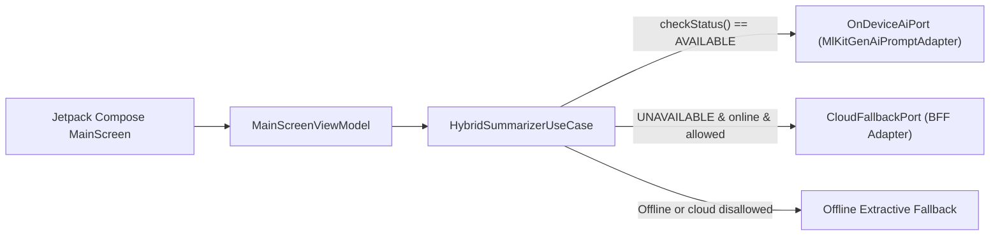

# Experiment 01: Android On-Device GenAI Summarizer (Gemini Nano / ML Kit)

**Classification:** `Experiment`  
**Track:** `05-android-on-device-ai`  
**Status:** `Completed`  
**Last Updated:** `2026-11-26`

---

## 1. Problem Statement

Enterprise Android field applications (logistics handhelds, driver apps, retail store tablets) frequently operate in connectivity dead zones and handle sensitive operational notes. However, hardware support for on-device **Gemini Nano** via **AICore** varies across a mixed Android fleet.

This experiment demonstrates how to integrate `com.google.mlkit:genai-prompt` cleanly using **MVVM + Clean Architecture** so the app runs locally on supported devices (`FeatureStatus.AVAILABLE`), streams model downloads (`DOWNLOADABLE`), and degrades gracefully when unavailable or offline.

---

## 2. Relevant Technical Concepts

- **Three-Layer On-Device Stack:**
  1. **Gemini Nano:** Lightweight on-device foundation model.
  2. **Android AICore:** System service managing shared model weights, hardware NPU/GPU scheduling, and app isolation.
  3. **ML Kit GenAI Prompt API (`com.google.mlkit:genai-prompt:1.0.0-beta5`):** Kotlin coroutine/Flow client (`Generation.getClient()`, `checkStatus()`, `download()`, `generateContent()`, `.close()`), requiring `minSdk 26+`.
- **Hybrid Edge–Cloud Routing ([ADR-0004](../../06-ai-system-architecture/adr-0004-android-hybrid-edge-cloud-routing.md)):** Never couple `ViewModel` directly to `GenerativeModel`; isolate it behind `OnDeviceAiPort` and route through `HybridSummarizerUseCase`.

---

## 3. Objectives & Success Criteria

- [x] Integrate `com.google.mlkit:genai-prompt:1.0.0-beta5` behind a Clean Architecture `OnDeviceAiPort` interface.
- [x] Implement `HybridSummarizerUseCase` routing across `ON_DEVICE_GEMINI_NANO`, `CLOUD_FALLBACK`, and `OFFLINE_EXTRACTIVE_FALLBACK` (respecting privacy policy toggles).
- [x] Build a Jetpack Compose Material 3 UI (`MainScreen.kt`) with AICore status, download progress, privacy/network simulation toggles, and route latency display.
- [x] Verify routing and ViewModel lifecycle (`.close()` on `onCleared()`) with JVM unit tests (`./gradlew test`).

---

## 4. Prerequisites & Setup

- Android SDK (`compileSdk 36`, `minSdk 26`) and JDK 17+ (run via Gradle wrapper `./gradlew`).
- Physical Gemini Nano / AICore testing requires a supported Android device; JVM unit tests run offline using fake ports.

```bash
cd 05-android-on-device-ai/exp-01-android-on-device-summarizer
./gradlew test
```

---

## 5. Solution Design & Architecture

See [ADR-0004](../../06-ai-system-architecture/adr-0004-android-hybrid-edge-cloud-routing.md) for the full options analysis.



---

## 6. Running & Testing

```bash
cd 05-android-on-device-ai/exp-01-android-on-device-summarizer
./gradlew testDebugUnitTest
```

### Observed Test Scope
- `./gradlew testDebugUnitTest --console=plain` — `BUILD SUCCESSFUL` with zero Kotlin warnings (`compileSdk 36`, `minSdk 26`, `com.google.mlkit:genai-prompt:1.0.0-beta5`).
- JVM Unit Tests: `6` passed (`HybridSummarizerUseCaseTest`: 4 tests; `MainScreenViewModelTest`: 2 tests), verifying `AVAILABLE` -> on-device routing, `DOWNLOADABLE` -> Flow progress, `UNAVAILABLE` + privacy gate -> offline extractive fallback, cloud fallback recovery, and `.close()` on `onCleared()`. Physical AICore device execution was not run in this environment.

---

## 7. Limitations, Security & Known Issues

- **Demo cloud adapter:** `DemoCloudFallbackAdapter` is a local placeholder illustrating the Clean Architecture port boundary; wiring it via Ktor/Retrofit to a live Python AI BFF belongs to the Month 6 capstone.
- **No instrumented AICore device run in CI:** Unit tests verify routing, Flow download state, privacy policies, and `.close()` cleanup via fakes on JVM; physical Gemini Nano inference must be verified on supported Pixel/Android AICore hardware.

---

## 8. What I Learned

- Treating Gemini Nano availability as a runtime state machine (`AVAILABLE` / `DOWNLOADABLE` / `UNAVAILABLE`) rather than assuming hardware presence prevents crashes across heterogeneous Android fleets.
- Keeping `MlKitGenAiPromptAdapter` behind `OnDeviceAiPort` preserves fast JVM unit testing of AI routing and privacy gates.

---

## 9. Possible Next Experiments

1. **Month 5 (`06-ai-system-architecture/`):** Design the end-to-end **Mobile-to-AI Gateway / BFF Reference Architecture**, OWASP LLM threat model, and cost/latency analysis.
2. **Month 6 Capstone:** Connect this Android client over HTTP to our Python RAG + HITL Agent BFF.
