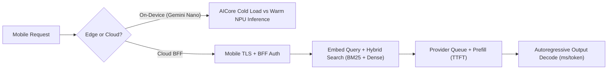

# Architecture Study 02: Cost, Latency & Observability Engineering

**Classification:** `Architecture Study`  
**Track:** `06-ai-system-architecture`  
**Status:** `Completed`  
**Last Updated:** `2026-11-26`

---

## 1. Latency Anatomy: Edge vs. Cloud vs. RAG

End-to-end user-perceived latency splits into distinct stages:

### Key Engineering Observations
- **Output tokens dominate cloud latency:** Prompt prefill scales well, whereas output generation is sequential (one token per step). Keeping `max_output_tokens` tight and using concise JSON schemas reduces both p95 latency and spend.
- **TTFT vs. Total Time (`02-llm-experiments/exp-02`):** Streaming SSE/NDJSON dramatically improves perceived mobile responsiveness for long explanations, whereas non-streaming structured JSON is simpler for automated tool/agent parsing.
- **On-device trade-off (`05-android-on-device-ai`):** Eliminates cellular network RTT (`100–600 ms+` in field zones) when warm, but first-time AICore download (`FeatureStatus.DOWNLOADABLE`) must run asynchronously via `Flow` without blocking UI workflows.

---

## 2. FinOps & Cost Optimization Levers

| Lever | Mechanism | Architectural Impact |
| --- | --- | --- |
| **1. Hybrid Edge Offloading** | Run routine field-note summaries on Gemini Nano (`$0` token spend) | Shifts compute from cloud opex to user device (`ADR-0004`) |
| **2. Model Tiering** | Route classification/extraction to Flash-Lite / Haiku / 8B local; reserve larger models for complex synthesis | 5x–20x cost reduction with comparable structured accuracy |
| **3. Context Budgeting** | Reserve output tokens and prune low-priority middle chunks (`drop_middle`) + `:countTokens` preflight (`02-llm/exp-03`) | Caps worst-case input cost per request |
| **4. Exact & Semantic Caching** | Cache deterministic normalized queries (e.g., standard policy lookups) in Redis before calling LLM | Cuts both token cost and p50 latency to single-digit ms |
| **5. Prompt & Output Discipline** | Enforce compact JSON schemas instead of chatty prose | Output tokens typically cost 3x–5x more per million than input tokens |

### Illustrative Request Cost Formula (from `02-llm-experiments/exp-03`)

$$\text{Cost}_{\text{req}} = \frac{\text{InputTokens}}{10^6} \times R_{\text{in}} + \frac{\text{OutputTokens}}{10^6} \times R_{\text{out}}$$

*(Multi-step agent workflows multiply input tokens on every step because full `ConversationTurn` history is re-sent—making `max_steps` caps critical for FinOps as well as safety.)*

---

## 3. Observability & Continuous Evaluation Strategy

### Distributed Tracing Across Mobile -> BFF -> LLM
Propagate a single `X-Correlation-ID` (`run_id`) across every boundary without logging raw secrets or unredacted PII:
- **Mobile Span:** `route_used` (`ON_DEVICE_GEMINI_NANO | CLOUD_FALLBACK | OFFLINE_EXTRACTIVE_FALLBACK`), `device_status`, `client_latency_ms`.
- **Retriever Span:** `retrieval_mode` (`dense | bm25 | hybrid`), `top_k`, `rrf_k`, `retrieved_chunk_ids`, `store_latency_ms`.
- **LLM Span:** `provider`, `model`, `input_tokens`, `output_tokens`, `ttft_ms`, `total_latency_ms`, `attempts`, `finish_reason`.
- **Safety / HITL Span:** `abstained`, `invalid_citations_count`, `pending_action_id`, `approval_decision`, `reviewer`.

### CI Evaluation Gates
Prevent silent quality regressions when prompts, chunk sizes, or models change by running deterministic checks in CI (`.github/workflows/ci.yml`):
1. **Retrieval gate:** `mean_recall_at_k` and `mrr` on curated paraphrase + exact-identifier (`SKU-4812-X`) cases.
2. **Faithfulness gate:** `citation_validity_rate == 1.0` and `abstention_accuracy` on unanswerable queries.
3. **Safety gate:** Policy caps (`MAX_REFUND_USD`) and `PENDING_APPROVAL` halting on prompt-injection test cases.
