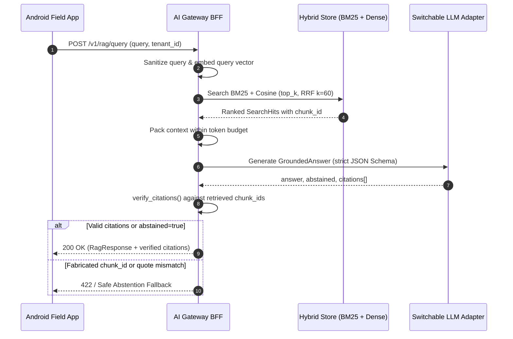
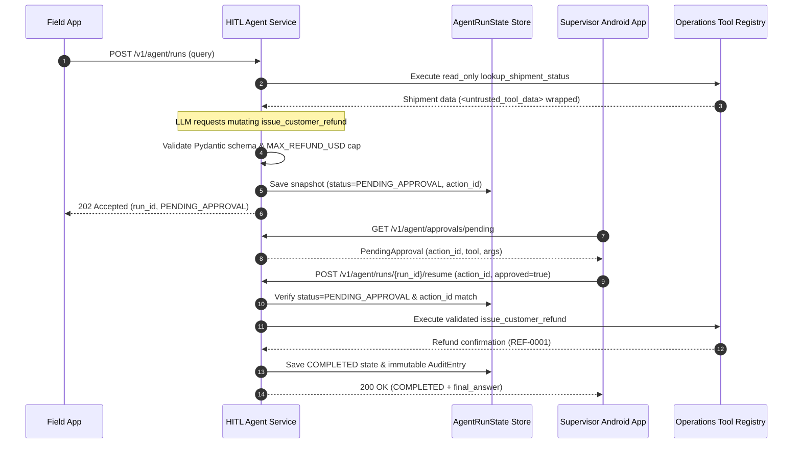

# Data-Flow Diagrams: Grounded Hybrid RAG & Async HITL Approval

**Classification:** `Architecture Study`  
**Related Study:** [ref-01-mobile-ai-gateway-architecture.md](../06-ai-system-architecture/ref-01-mobile-ai-gateway-architecture.md)

## 1. Grounded Hybrid RAG Request Flow

## 2. Asynchronous HITL Mutating Action Flow

