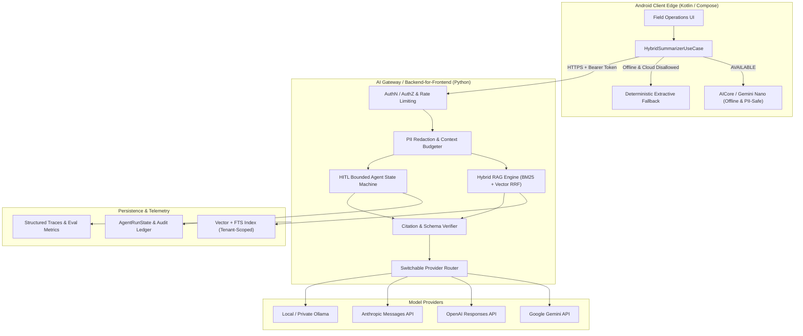

# System Architecture Diagram: Mobile-to-AI Gateway (BFF)

**Classification:** `Architecture Study`  
**Related Study:** [ref-01-mobile-ai-gateway-architecture.md](../06-ai-system-architecture/ref-01-mobile-ai-gateway-architecture.md)

