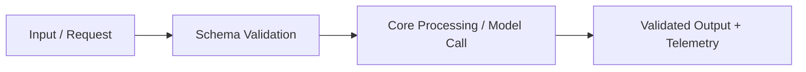

# <Experiment / Project Title>

**Classification:** `<Experiment | Proof of Concept | Reference Implementation | Architecture Study>`  
**Track:** `<e.g., 02-llm-experiments>`  
**Status:** `<In Progress | Completed | Archived>`  
**Last Updated:** `<YYYY-MM-DD>`

---

## 1. Problem Statement

*What specific engineering problem, ambiguity, or capability gap is this work exploring?*

---

## 2. Relevant Technical Concepts

*Explain the core concepts in plain engineering terms: what the technology is, why it exists, how it works under the hood, and how it compares to alternatives.*

---

## 3. Objectives & Success Criteria

- [ ] Objective 1 (measurable outcome)
- [ ] Objective 2 (measurable outcome)
- [ ] Objective 3 (test / verification target)

---

## 4. Prerequisites & Setup

### Requirements
- Python `3.13+` (or specific runtime/SDK versions)
- `uv` (or `pip`)
- Required API keys or local services (if applicable)

### Setup Steps

```bash
cd <track>/<experiment-directory>
uv sync
cp .env.example .env
# Populate required variables in .env (never commit .env)
```

### Environment Variables

| Variable | Required | Description | Default |
| --- | --- | --- | --- |
| `EXAMPLE_API_KEY` | Yes (live run) | Provider API key for live integration checks | None |

---

## 5. Solution Design & Architecture

*Document the design **before** writing code. Include a Mermaid diagram for non-trivial flows.*



### Component Responsibilities
- **Component A:** Responsibility and boundary.
- **Component B:** Responsibility and boundary.

### Selected Technologies & Trade-offs

| Choice | Alternatives Considered | Why Selected | Trade-offs / Revisit Trigger |
| --- | --- | --- | --- |
| `<Library / Approach>` | `<Alternative 1, 2>` | `<Reasoning>` | `<Known downside & when to switch>` |

*(For POCs and Reference Implementations, also link relevant ADRs in `06-ai-system-architecture/` or local `adr/`.)*

---

## 6. Implementation Notes

*Summarize key modules, file layout, and important engineering decisions (error handling, retries, timeouts, logging, security boundaries).*

```text
<experiment-directory>/
├── README.md
├── pyproject.toml
├── .env.example
├── src/
└── tests/
```

---

## 7. Expected Inputs & Outputs

### Example Input
```json
{
  "example": "input payload"
}
```

### Example Output
```json
{
  "example": "structured output"
}
```

---

## 8. Running & Testing

```bash
# Run automated unit tests (offline / mocked)
uv run pytest

# Run the example script (if applicable)
uv run python -m <package.module>
```

### Observed Test Scope
*Record exact command run, pass/fail counts, and whether external APIs were mocked or live.*

---

## 9. Limitations, Security & Known Issues

- **Scope boundary:** Personal learning experiment / POC; not hardened for production traffic.
- **Known technical limits:** (e.g., latency, token limits, evaluation dataset size, error modes).
- **Security / privacy notes:** (e.g., PII handling, prompt injection exposure, key storage).

---

## 10. What I Learned

*Concise engineering reflections: what behaved differently than expected, what architectural intuition carried over from mobile/enterprise systems, and what trade-offs matter most.*

---

## 11. Possible Next Experiments

1. Follow-up idea 1 (and what question it answers)
2. Follow-up idea 2 (and what question it answers)
